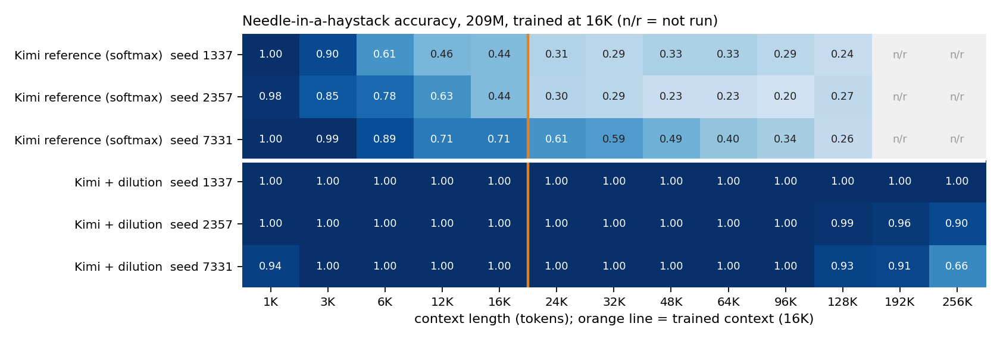
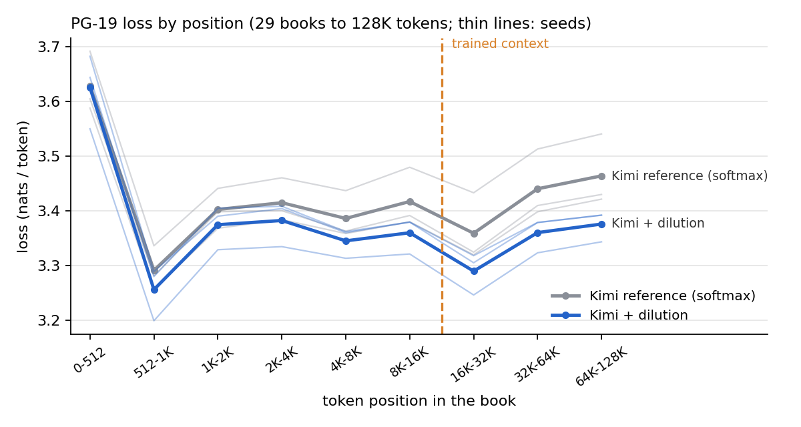

# Kimi Linear's layout with dilution attention

[](https://doi.org/10.5281/zenodo.24269647)

What happens if you take the hybrid layout of Kimi Linear (three Kimi Delta Attention layers, then one full attention
layer) and swap the softmax in those attention layers for
[dilution attention](https://github.com/Royer-Research-Labs/dilution-attention), a parameter-free attention operator?

At 209M parameters, 16K training context and three seeds per model:

- **Lower loss on every seed:** 2.985 vs 3.031 nats on held-out FineWeb-Edu (-0.046; seed spread under 0.007).
- **Retrieval that holds past the training context:** needle-in-a-haystack accuracy 1.00 on every seed from the 16K
  training length out to 96K tokens (6x) and 0.66-1.00 at 256K (16x), with no position scaling or fine-tuning. The
  softmax reference scores 0.44-0.71 at its own 16K training length and 0.24-0.27 at 128K.
- **Same parameters, slower training:** dilution adds no parameters; it trains about 19% slower in this model.



*Every seed of both models. Both have 208,514,136 parameters, the same data, schedule and seed set, and differ only in the
operator inside the six attention layers. Cells right of the orange line are longer than anything seen in training.*

## What is compared

| | Kimi reference | Kimi + dilution |
|---|---|---|
| Layers | [KDA, KDA, KDA, softmax attention] x 6 | [KDA, KDA, KDA, dilution attention] x 6 |
| Position encoding | none | none |
| Parameters | 208,514,136 | 208,514,136 |
| Common-slice loss (3 seeds) | 3.0310 / 3.0338 / 3.0282 | 2.9852 / 2.9883 / 2.9818 |
| NIAH at 16K (trained length) | 0.44 / 0.44 / 0.71 | 1.00 / 1.00 / 1.00 |
| NIAH at 128K (8x) | 0.24 / 0.27 / 0.26 | 1.00 / 0.99 / 0.93 |
| Training throughput | 69.3K tok/s | 56.1K tok/s |

24 layers, d_model 768, 12 heads, SwiGLU, GPT-2 tokenizer; FineWeb-Edu, 16,384-token context, 4.19B tokens (about 1x
Chinchilla) on the published DilutionAttention 16K recipe. KDA is flash-linear-attention's implementation (fla-core).

**Dilution attention in one paragraph.** Each query places its bids with an ordinary softmax, but before a bid is
honoured it is divided by the demand that key has already received from earlier queries, and the query's shares are
renormalised. A key nobody has wanted yet is cheap; a key half the sequence has already claimed is expensive. There are
no learnable parameters. Definition, kernels and the original study:
[Royer-Research-Labs/dilution-attention](https://github.com/Royer-Research-Labs/dilution-attention).

## Beyond the headline

Details, per-seed tables and caveats are in [docs/results.md](docs/results.md). In short:

- **Harder retrieval.** With natural-text filler instead of repeated filler, dilution stays at 0.97-1.00 to 64K, while
  the reference falls to about 0.2. With three keyed distractors, dilution almost always returns *one* of the keyed
  values, but neither model reliably returns the *right* one (30-52% of keyed answers correct, against 25% by chance).
  Dilution helps finding, not binding, at this scale.
- **Long documents.** On PG-19 books to 128K tokens, neither model's loss degrades past the training context. Dilution
  is lower beyond 32K on every seed, by a seed-dependent margin (0.03-0.15 nats at 64K-128K), and it is the only one of
  the two that gains from text more than 16K tokens back (0.012-0.026 nats).
- **Mechanism.** Every dilution seed forms retrieval heads in the same two mid-stack attention layers, with 0.84-1.00 of
  a head's attention on the needle. No attention layer of the reference attends to the needle on any seed.



## Caveats

- The reference uses Kimi Linear's *layout* with standard multi-head softmax attention; Kimi Linear itself uses
  Multi-head Latent Attention in those layers.
- One scale (209M), one context (16K), one token budget (about 1x Chinchilla). No downstream benchmarks yet.
- The extrapolation range past 96K depends on the seed (0.66-1.00 at 256K).
- Dilution trains about 19% slower here and uses 11% more peak memory (57.1 vs 51.5 GiB).

## Getting started

This repository is the public DilutionAttention harness (vendored at commit 9957298; `vendored.json` lists every file
and the one edit) plus a KDA layer type (`src/dilution/mixers.py`) and the configs, run records and results for this
comparison.

```bash
pip install "torch>=2.4" pyyaml fla-core==0.6.0 tiktoken datasets matplotlib pytest   # Triton ships with CUDA torch
PYTHONPATH=src python -m pytest -q tests          # CPU tests; kernel parity tests run when CUDA is available
```

- **Data.** The 40B-token FineWeb-Edu corpus rebuilds exactly with the command in the DilutionAttention repository's
  [docs/reproducing.md](https://github.com/Royer-Research-Labs/dilution-attention/blob/main/docs/reproducing.md);
  configs expect it at `data/fineweb_edu_100bt_40b/`. Every run record stores the corpus SHA-256.
- **Training and evaluation.** `SEEDS="1337 2357 7331" bash runs/run_kimi.sh` trains both models and runs the
  common-slice loss and NIAH ladders; `runs/eval_kimi_extra.sh` runs the PG-19, distant-text, hard-mode and attention
  probes. Retrieval uses [Royer-Research-Labs/Niah](https://github.com/Royer-Research-Labs/Niah) (set
  `DILUTION_NIAH_ROOT`).
- **Figures.** `PYTHONPATH=src python scripts/make_kimi_figures.py`.
- **Records.** Configs under `configs/scale_16384/`, run records (metrics, resolved config, data provenance,
  environment; no checkpoints) under `runs/scale_16384/`, evaluation outputs under `results/`.

## Credits and license

Apache-2.0 (see `LICENSE` and `NOTICE`). Kimi Delta Attention and the Kimi Linear layout are Moonshot AI's
([arXiv 2510.26692](https://arxiv.org/abs/2510.26692)); the KDA layer follows flash-linear-attention (MIT) and calls its
Triton kernel. The needle-in-a-haystack hard mode and distant-text control come from
[Selective-Attention-Study](https://github.com/Royer-Research-Labs/Selective-Attention-Study).

If you use these results, please cite this repository
([10.5281/zenodo.24269647](https://doi.org/10.5281/zenodo.24269647); see `CITATION.cff`), the DilutionAttention
technical report ([10.5281/zenodo.23073151](https://doi.org/10.5281/zenodo.23073151)) and Kimi Linear.
