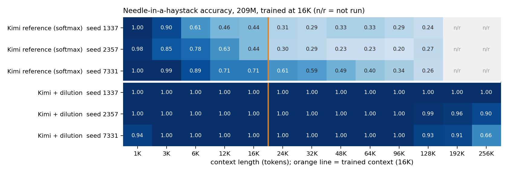
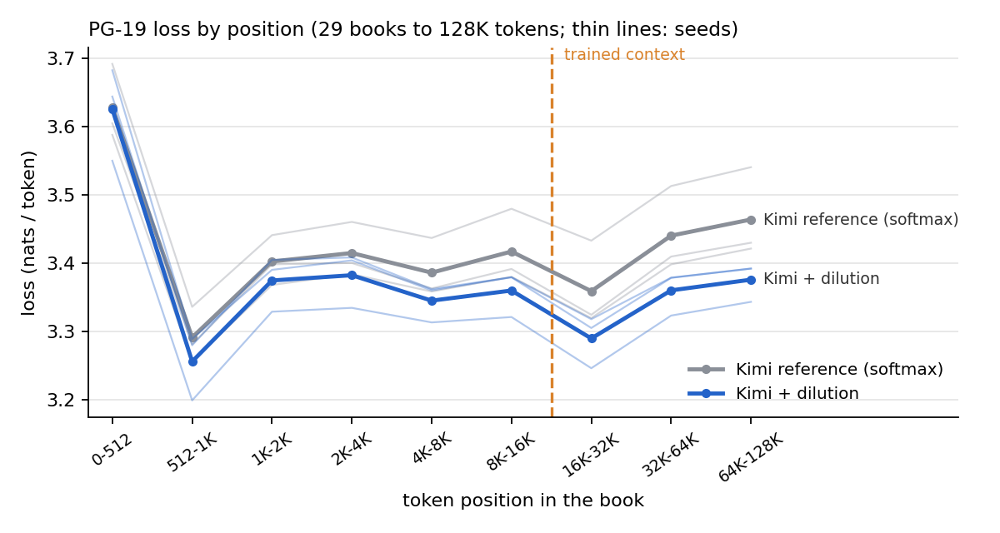

# Results: Kimi Linear's layer pattern with dilution attention

Two 209M-parameter models, three seeds each, identical except for the attention operator in the attention layers:

- **Kimi reference (softmax):** Kimi Linear's 3:1 layout, three Kimi Delta Attention (KDA) layers then one softmax
  attention layer, repeated six times (24 layers), with no position encoding in the attention layers.
- **Kimi + dilution:** the same model with each softmax attention layer replaced by
  [dilution attention](https://github.com/Royer-Research-Labs/dilution-attention).

Dilution attention has no parameters, so both models have exactly 208,514,136 parameters and the same weight shapes.
Everything below is read from the JSON files under `results/` and the run records under `runs/scale_16384/`.

## Setup

| | |
|---|---|
| Model | 24 layers, d_model 768, 12 heads, SwiGLU FFN (width 1977), no biases, GPT-2 tokenizer (vocab 50,304) |
| Layer pattern | [KDA, KDA, KDA, attention] x 6 |
| KDA | flash-linear-attention's parameterisation and chunked Triton kernel (fla-core 0.6.0); its short convolutions are the only source of token order |
| Position encoding | none, in either model |
| Data | FineWeb-Edu sample-100BT, 40B-token corpus (pinned revision; rebuild command in the DilutionAttention repository) |
| Context | 16,384 tokens; 65,536 tokens per step |
| Schedule | the published DilutionAttention 16K recipe: AdamW, LR 6e-4, 1,000 warmup steps, cosine to 0.1x over 128,174 steps, stopped at step 64,000 (4.19B tokens, about 1x Chinchilla); weight decay 0.1 (none on KDA's `A_log` / `dt_bias`), grad clip 1.0, bf16 autocast |
| Seeds | 1337, 2357, 7331 |
| Hardware | one NVIDIA RTX PRO 6000 Blackwell Workstation Edition (96 GB); PyTorch 2.13, CUDA 13.0 |

The harness is the public DilutionAttention release (`vendored.json` lists every file and the single edit). The KDA layer
(`src/dilution/mixers.py`) is the only new model code.

## 1. Language-modelling loss

Common-slice evaluation: the published script and slice (64 batches x 2 windows of 16,384 tokens from the held-out split).

| seed | Kimi reference | Kimi + dilution | difference |
|---|---|---|---|
| 1337 | 3.0310 | 2.9852 | -0.0458 |
| 2357 | 3.0338 | 2.9883 | -0.0455 |
| 7331 | 3.0282 | 2.9818 | -0.0463 |
| **mean** | **3.0310** | **2.9851** | **-0.0459** |

The seeds of each model span 0.0057 (reference) and 0.0065 (dilution) nats; the gap is about seven times that spread and
has the same size on every seed. In training, the in-run validation gap was 0.036-0.052 from step 4,000 onward (seed 1337),
so the advantage is not a late-schedule effect.

## 2. Retrieval (needle in a haystack)

The Niah harness ([Royer-Research-Labs/Niah](https://github.com/Royer-Research-Labs/Niah)), 8 needles with one
disqualified by the control prior (7 scored, chance about 0.14); 20 placements per needle up to 16K, 10 beyond. No
scaling or fine-tuning is applied past the training context.



| context | Kimi reference (seeds 1337 / 2357 / 7331) | Kimi + dilution (seeds 1337 / 2357 / 7331) |
|---|---|---|
| 3K | 0.90 / 0.85 / 0.99 | 1.00 / 1.00 / 1.00 |
| 6K | 0.61 / 0.78 / 0.89 | 1.00 / 1.00 / 1.00 |
| 16K (trained) | 0.44 / 0.44 / 0.71 | 1.00 / 1.00 / 1.00 |
| 32K (2x) | 0.29 / 0.29 / 0.59 | 1.00 / 1.00 / 1.00 |
| 64K (4x) | 0.33 / 0.23 / 0.40 | 1.00 / 1.00 / 1.00 |
| 96K (6x) | 0.29 / 0.20 / 0.34 | 1.00 / 1.00 / 1.00 |
| 128K (8x) | 0.24 / 0.27 / 0.26 | 1.00 / 0.99 / 0.93 |
| 192K (12x) | not run | 1.00 / 0.96 / 0.91 |
| 256K (16x) | not run | 1.00 / 0.90 / 0.66 |

- The reference loses retrieval **inside** its own training context (0.44-0.71 at 16K).
- Dilution is perfect on every seed from 3K to 96K, six times the training context (below 2K, seed 7331 scores
  0.94-0.99). Past 96K the range depends on the seed: one seed is still perfect at 256K, the others fall to 0.90 and
  0.66.
- **When retrieval forms.** On the kept step-16,000 checkpoints, two dilution seeds already score 1.00 at 16K, 64K and
  128K; seed 7331 scores 0.74 / 0.49 / 0.47 and reaches 1.00 / 0.94 / 0.87 by step 32,000. The reference stays at
  0.14-0.41 at both checkpoints.

## 3. Harder retrieval: natural filler and keyed distractors

Niah hard mode (Selective-Attention-Study's `niah_hard.py`): the haystack is natural PG-19 text instead of repeated
filler, and optionally contains three distractor needles that share the query's key format but carry other values.

**No distractors (natural filler only):**

| context | Kimi reference | Kimi + dilution |
|---|---|---|
| 4K | 0.39 / 0.41 / 0.49 | 1.00 / 1.00 / 1.00 |
| 16K | 0.27 / 0.24 / 0.29 | 1.00 / 1.00 / 1.00 |
| 64K | 0.23 / 0.24 / 0.21 | 1.00 / 0.97 / 0.99 |
| 128K | 0.20 / 0.20 / 0.17 | 0.94 / 0.84 / 0.77 |

**Three keyed distractors.** Accuracy alone mixes two abilities, so the table splits it: *found* is the fraction of
answers that are one of the four keyed values (the needle or a distractor); *bound* is the fraction of those that are the
right one. Choosing at random among the four keyed values gives bound = 0.25.

| context | reference: found | reference: bound | dilution: found | dilution: bound |
|---|---|---|---|---|
| 16K | 0.56-0.66 | 0.37-0.46 | 0.99-1.00 | 0.30-0.36 |
| 32K | 0.47-0.60 | 0.41-0.52 | 0.97-1.00 | 0.35-0.43 |
| 64K | 0.43-0.53 | 0.39-0.43 | 1.00 | 0.37-0.43 |
| 128K | 0.47-0.61 | 0.33-0.39 | 0.94-0.99 | 0.36-0.41 |

(Ranges over the three seeds; per-seed values are in `results/investigate/niah_hard_d3_kimi_s*.json`.) Dilution almost
always returns one of the keyed values, at every length, where the reference finds one only about half the time. **Neither
model binds the key reliably:** given that a keyed value was returned, both pick the right one 30-52% of the time against
25% for a random choice. Dilution fixes finding; it does not fix binding at this scale.

## 4. Long documents: PG-19 loss by position

Mean loss per position range over 29 PG-19 books evaluated to 131,072 tokens (`scripts/long_perplexity.py`).



Dilution minus reference, per seed (paired over books; standard error in brackets):

| position | seed 1337 | seed 2357 | seed 7331 |
|---|---|---|---|
| 0-512 | +0.094 (0.027) | -0.048 (0.015) | -0.055 (0.021) |
| 4K-8K | +0.002 (0.009) | -0.075 (0.008) | -0.050 (0.005) |
| 8K-16K | -0.001 (0.010) | -0.100 (0.011) | -0.070 (0.005) |
| 16K-32K | -0.002 (0.015) | -0.128 (0.016) | -0.078 (0.008) |
| 32K-64K | -0.019 (0.011) | -0.134 (0.012) | -0.086 (0.008) |
| 64K-128K | -0.029 (0.011) | -0.148 (0.012) | -0.086 (0.008) |

Neither model degrades past its training context: both stay within the in-context range out to 128K. Dilution is lower
beyond 32K on every seed, but the size of the gap varies a lot between seeds, more than on the common slice. The
reference's seed 2357 is 0.05-0.1 worse than its other two seeds at every position, including inside 16K. That run was
interrupted by a hardware fault and resumed (see Notes), and its common-slice loss is normal, so treat its PG-19 gap as
the least reliable of the three.

**Does the model use text beyond its window?** The same books scored with the full prefix and with only the most recent
16,384 tokens (`scripts/investigate/rolling_window.py`); the difference is the gain from distant text (negative = helps).

| position | reference (1337 / 2357 / 7331) | dilution (1337 / 2357 / 7331) |
|---|---|---|
| 16K-32K | -0.002 / +0.000 / -0.002 | -0.015 / -0.015 / -0.012 |
| 32K-64K | -0.003 / +0.003 / -0.002 | -0.019 / -0.022 / -0.014 |
| 64K-128K | -0.002 / +0.003 / -0.002 | -0.022 / -0.026 / -0.015 |

The reference gets nothing from text more than 16K tokens back. Dilution gets a small, consistent gain (0.012-0.026 nats)
that grows with the amount of distant text, on all three seeds.

## 5. Mechanism: attention on the needle

Maximum attention mass any head in a layer puts on the needle tokens, at 7,936 tokens of context
(`scripts/investigate/needle_attention_hybrid.py`; KDA layers record zero). The attention layers are layers 4, 8, 12, 16,
20 and 24.

| seed | Kimi reference | Kimi + dilution |
|---|---|---|
| 1337 | 0.00 0.00 0.00 0.00 0.00 0.00 | 0.01 0.01 **0.98 0.99** 0.39 0.02 |
| 2357 | 0.00 0.00 0.00 0.00 0.00 0.00 | 0.01 0.01 **0.95 0.91** 0.39 0.01 |
| 7331 | 0.00 0.00 0.00 0.00 0.00 0.00 | 0.01 0.01 **1.00 0.84** 0.14 0.02 |

Every dilution seed forms retrieval heads in the same two mid-stack attention layers (12 and 16), putting nearly all of a
head's attention on the needle. No attention layer of the reference attends to the needle on any seed. Whatever retrieval
the reference does inside its context goes through other routes (KDA state or diffuse attention), and it does not survive
longer contexts.

## 6. Cost

| | Kimi reference | Kimi + dilution |
|---|---|---|
| Parameters | 208,514,136 | 208,514,136 |
| Training throughput (median, tok/s) | 69,300 | 56,100 (-19%) |
| Peak memory allocated (GiB) | 51.5 | 57.1 |
| Wall time to 4.19B tokens | about 17 h | about 21 h |

Dilution trains about 19% slower in this model. Only one layer in four is attention; the gap comes entirely from those
six layers. Inference kernels (forward-only prefill with linear memory, split-key cached decode) are documented and
benchmarked in [docs/kernels.md](kernels.md); end-to-end inference speed of these two models has not been measured yet.

## Notes and caveats

- **The reference is Kimi Linear's layout, not Kimi Linear.** Kimi Linear's attention layers are Multi-head Latent
  Attention (MLA) with no position encoding; here they are standard multi-head softmax attention with no position
  encoding. The comparison is softmax vs dilution in the same layout and recipe.
- **One scale and one token budget.** 209M parameters, 16K context, about 1x Chinchilla tokens. Nothing here says how the
  gap behaves at larger scale or longer training.
- **No downstream benchmarks yet.** The evidence is held-out loss, long-document loss and synthetic retrieval.
- **Hardware fault.** Reference seed 2357 stopped at step 42,225 on a driver-level `CUDA error: unknown error` (loss and
  gradients were normal) and was resumed from its step-42,000 checkpoint, repeating 225 steps. Its common-slice loss
  (3.0338) is the highest of the three seeds, by 0.003.
- **Kernel versions.** Seed 1337 of both models trained on DilutionAttention kernel 4d09a18; seeds 2357 and 7331 on the
  faster 9957298 kernel, whose outputs agree at rounding level. Throughput above uses seeds 2357 / 7331 for dilution (seed
  1337: 53,900 tok/s); the reference does not use the dilution kernel.

## Reproducing

```bash
SEEDS="1337 2357 7331" bash runs/run_kimi.sh                          # train, common-slice loss, NIAH ladders
SEEDS="1337 2357 7331" PG19=data/pg19_gpt2 bash runs/eval_kimi_extra.sh   # PG-19, distant text, hard mode, needle attention
PYTHONPATH=src python scripts/make_kimi_figures.py                    # figures in docs/figures/
```

Configs: `configs/scale_16384/kimi_softmax_nope.yaml` and `kimi_dilution.yaml` (they differ only in the operator).
`scripts/make_kimi_configs.py` writes them and matches the published 16K model's parameter count through the FFN width.
